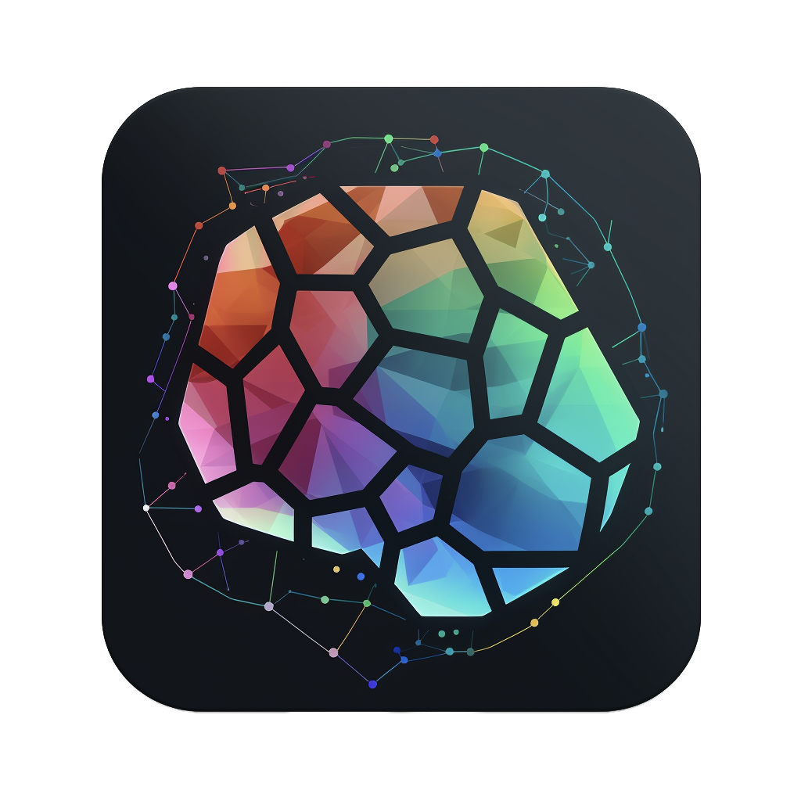
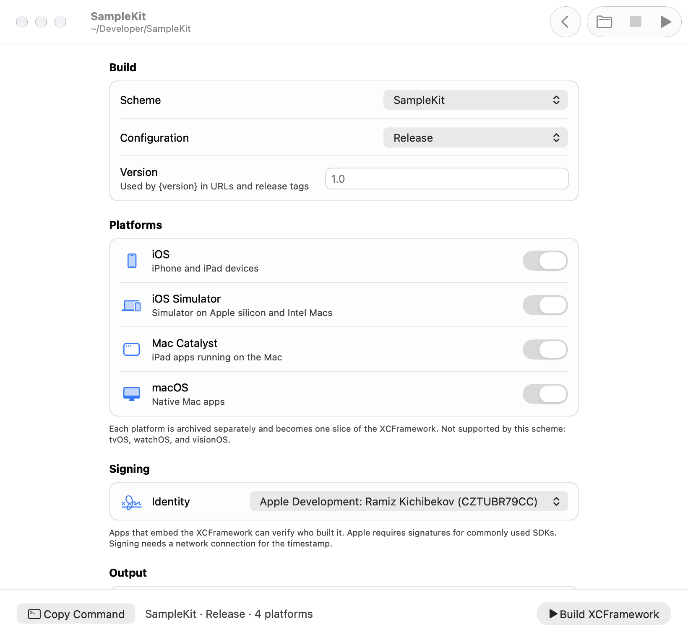
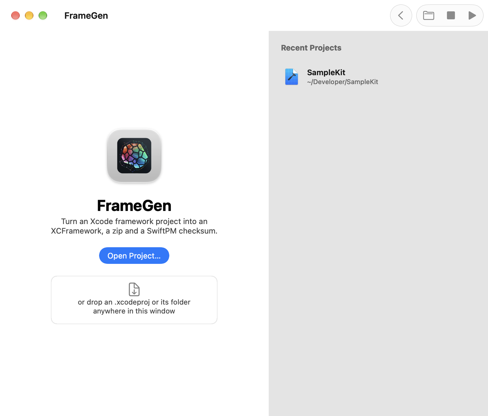
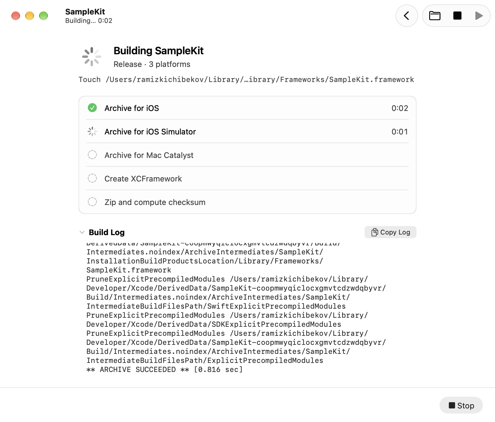
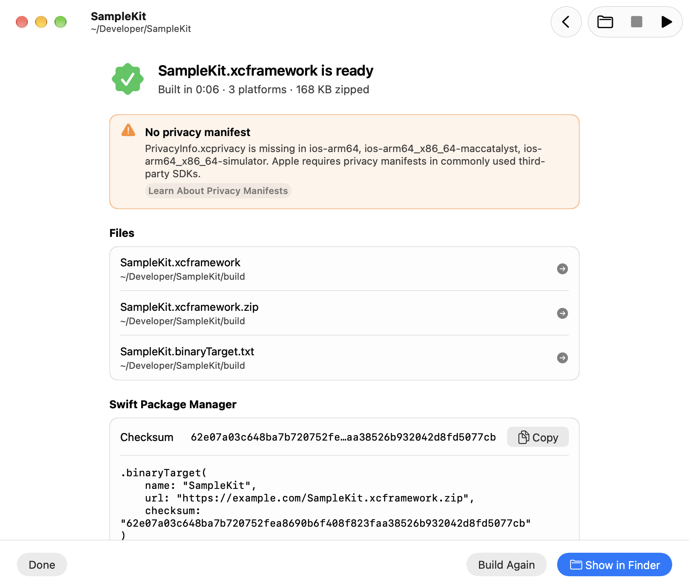

#  FrameGen

[](https://www.swift.org)
[](#requirements)
[](#features)
[](https://developer.apple.com/xcode/)
[](https://github.com/Ramiz69/FrameGen/releases/latest)
[](https://github.com/Ramiz69/homebrew-tap)
[](LICENSE)

FrameGen is a Mac app and a command-line tool that turn an Xcode framework project into a distributable **XCFramework**. Pick a scheme, press Build, and FrameGen archives every supported platform, assembles the XCFramework with its debug symbols, signs and zips it, publishes it, and gives you a ready-to-paste Swift Package Manager `binaryTarget` with the real download URL.



## Features

- **One-click XCFramework.** Runs `xcodebuild archive` for each selected platform, then `xcodebuild -create-xcframework` with the dSYM of every slice.
- **Projects and workspaces.** Opens `.xcodeproj` and `.xcworkspace` (including CocoaPods) and prefers the workspace next to a project.
- **Every Apple platform.** iOS, Mac Catalyst, macOS, tvOS, watchOS, visionOS and their simulators. FrameGen reads the scheme's `SUPPORTED_PLATFORMS` and only offers what the framework supports.
- **Code signing.** Optionally signs the XCFramework with a certificate from your keychain, with a secure timestamp, before the checksum is computed.
- **Ready for SwiftPM.** Zips the XCFramework, computes its checksum and writes a `.binaryTarget(...)` snippet next to it.
- **Publishing anywhere.** Uploads to a GitHub release with the GitHub CLI, or runs your own upload command for GitLab, Bitbucket, S3, Artifactory, Nexus or an internal server. The snippet then uses the real download URL.
- **Same pipeline in CI.** The `framegen` command-line tool ships inside the app; **Product › Copy Build Command** copies the equivalent invocation.
- **Privacy manifest check.** Warns when a slice ships without `PrivacyInfo.xcprivacy`, which Apple requires in commonly used third-party SDKs.
- **Live progress.** Shows each step with its status and duration, the current xcodebuild action and the full build log.
- **Readable failures.** Shows which step failed and pulls the compiler `error:` lines out of the log.
- **Remembers your choices.** Keeps the scheme, configuration, platforms and output folder of every project, plus a list of recent projects.
- **A native Mac app.** Menu bar commands with keyboard shortcuts, a toolbar, drag and drop, notifications when a build finishes in the background, Dark Mode, VoiceOver labels, English and Russian.

## Screenshots

| Start | Building |
| --- | --- |
|  |  |



## Install

With [Homebrew](https://brew.sh), which also puts `framegen` on your `PATH`:

```bash
brew install --cask ramiz69/tap/framegen
```

Or download `FrameGen-<version>.zip` from [Releases](https://github.com/Ramiz69/FrameGen/releases), unzip it and move FrameGen to Applications. Releases are signed with a Developer ID and notarized by Apple.

## Requirements

- A Mac with Apple silicon running macOS 27 or later.
- Xcode 27 or later, selected with `xcode-select`.
- A project with a shared framework scheme.

## Usage

1. Open a project with **File › Open Project…** (⌘O), pick one from **Recent Projects**, or drop an `.xcodeproj`, an `.xcworkspace` or their folder onto the window or the Dock icon.
2. Choose the scheme and configuration. The supported platforms appear and are all turned on; switch off the ones you don't need.
3. Optionally pick a signing identity and a distribution: a download URL, a GitHub release, or a custom upload command.
4. Press **Build XCFramework** (⌘B). Stop a build with ⌘. or Esc.
5. When the build finishes, **Publish** (⌘U) uploads the zip, or use **Show in Finder** and copy the checksum and the `binaryTarget` snippet.

FrameGen writes these files to `build/` next to the project. You can choose another folder per project, or set a shared default in **Settings** (⌘,).

```
build/
├── SampleKit.xcframework
├── SampleKit.xcframework.zip
├── SampleKit.binaryTarget.txt
└── Archives/            # one .xcarchive per platform; optional, see Settings
```

Archives are built with `SKIP_INSTALL=NO`, `BUILD_LIBRARIES_FOR_DISTRIBUTION=YES`, `SWIFT_ENABLE_LIBRARY_EVOLUTION=YES` and `SWIFT_EMIT_MODULE_INTERFACE=YES`, so Swift frameworks get the module interfaces that `-create-xcframework` needs.

### Distribution

| Publish | How it works |
| --- | --- |
| Upload manually | Optionally set a download URL template, e.g. `https://cdn.example.com/{name}/{version}/{zip}`, so the snippet has the final URL. |
| GitHub Release | Uses the [GitHub CLI](https://cli.github.com) (`gh auth login` once). Creates the release for the tag, e.g. `v{version}`, or replaces its asset. |
| Custom command | Runs your command in `zsh -l` with `{path}`, `{zip}`, `{name}`, `{version}` and `{checksum}` filled in and shell-quoted. Presets cover the GitLab Package Registry, Bitbucket Downloads, Amazon S3 and JFrog Artifactory. Define tokens such as `$GITLAB_TOKEN` in `~/.zprofile`. |

`{version}` is the scheme's `MARKETING_VERSION` unless you set one in the project options. SwiftPM downloads from private hosts with credentials in `~/.netrc`.

### Command-line tool

`framegen` runs the same pipeline as the app, so a build configured in FrameGen behaves the same in GitHub Actions, GitLab CI, Jenkins, TeamCity, Bitbucket Pipelines or Xcode Cloud. Install it with the cask, or use `/Applications/FrameGen.app/Contents/Helpers/framegen`.

```bash
framegen list --workspace Kit.xcworkspace
framegen build --workspace Kit.xcworkspace --scheme Kit --platform ios,ios-simulator,macos \
  --sign "Apple Distribution: Company" --version 2.1 \
  --download-url 'https://cdn.example.com/{name}/{version}/{zip}' --output build --json
```

Without `--platform` it builds every platform the scheme supports. `--publish github` or `--publish command --publish-command '…'` uploads after building. Progress goes to stderr and the result to stdout, as text or JSON. Exit codes: 0 success, 1 build failure, 2 usage error, 130 interrupted. Run `framegen help` for every option.

### Keyboard shortcuts

| Action | Shortcut |
| --- | --- |
| Open Project | ⌘O |
| Close Project | ⇧⌘W |
| Build XCFramework | ⌘B |
| Stop | ⌘. |
| Publish | ⌘U |
| Copy Build Command | ⌥⌘C |
| Show Output in Finder | ⇧⌘R |
| Settings | ⌘, |

## Building from source

Open `FrameGen.xcodeproj` in Xcode 27 and run the **FrameGen** scheme, or build it from the command line:

```bash
xcodebuild -project FrameGen.xcodeproj -scheme FrameGen -configuration Release build
```

Run the tests (Swift Testing). The engine and the tool are tested as a package, the app with Xcode:

```bash
swift test --package-path Packages/FrameGenKit
```

```bash
xcodebuild test -project FrameGen.xcodeproj -scheme FrameGen -destination 'platform=macOS,arch=arm64' CODE_SIGNING_ALLOWED=NO
```

CI runs both on every pull request to `main` (see `.github/workflows/ci.yml`). During development, `swift run --package-path Packages/FrameGenKit framegen-dev help` runs the tool without Xcode.

The app runs `xcodebuild` on your projects, so it can't use the App Sandbox. That also means it can't ship on the Mac App Store; releases are signed with a Developer ID and notarized instead. See [docs/RELEASING.md](docs/RELEASING.md) for the release process.

## Architecture

FrameGen uses AppKit with Apple's Model-View-Controller pattern and Swift 6 concurrency. The build engine lives in a local Swift package that both the app and the tool use.

| Part | Contents |
| --- | --- |
| `Packages/FrameGenKit` — `FrameGenKit` | The engine, with no UI: `XCFrameworkPipeline` runs a `BuildRequest` and reports `PipelineEvent`s. Also `ProcessRunner`, `XcodeCommand`, `XCFrameworkBuilder`, `ProjectLocator`, `ProjectInfo`, `SchemeBuildInfo`, `SigningIdentity`, `Template` and `Publisher`. |
| `Packages/FrameGenKit` — `FrameGenCLI` | The `framegen` commands and the `BuildArguments` parser, which also prints the app's "Copy Build Command". |
| `FrameGenCLI/main.swift` | The Xcode target that builds the tool into `FrameGen.app/Contents/Helpers`. |
| `FrameGen/Models` | `Workspace`, `Project` and `BuildState` are `@Observable` classes; settings persist per project. |
| `FrameGen/Controllers` | `NSViewController` subclasses for every screen, plus `BuildController`, which adapts pipeline events to the UI and publishes results. |
| `FrameGen/Views` | Reusable `NSView` subclasses: form sections, step rows, log view, callouts, drop target. |
| `FrameGen/Services` | Preferences, open panels and build notifications. |
| `FrameGen/Window`, `Application` | The main window and its toolbar, the menu bar and the app delegate. |

View controllers follow their models with `withObservationTracking` (see `Support/ObservationLoop.swift`), so the UI updates whenever the state changes.

## License

FrameGen is available under the MIT license. See [LICENSE](LICENSE).
